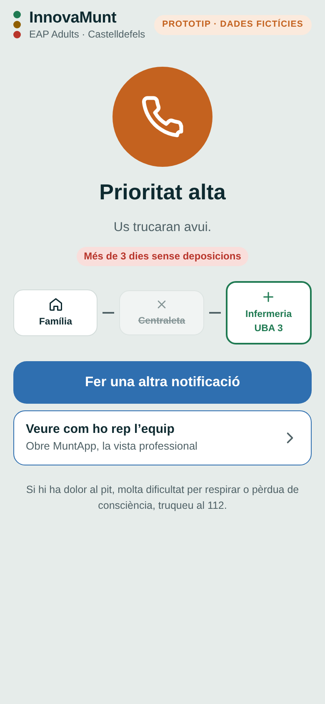
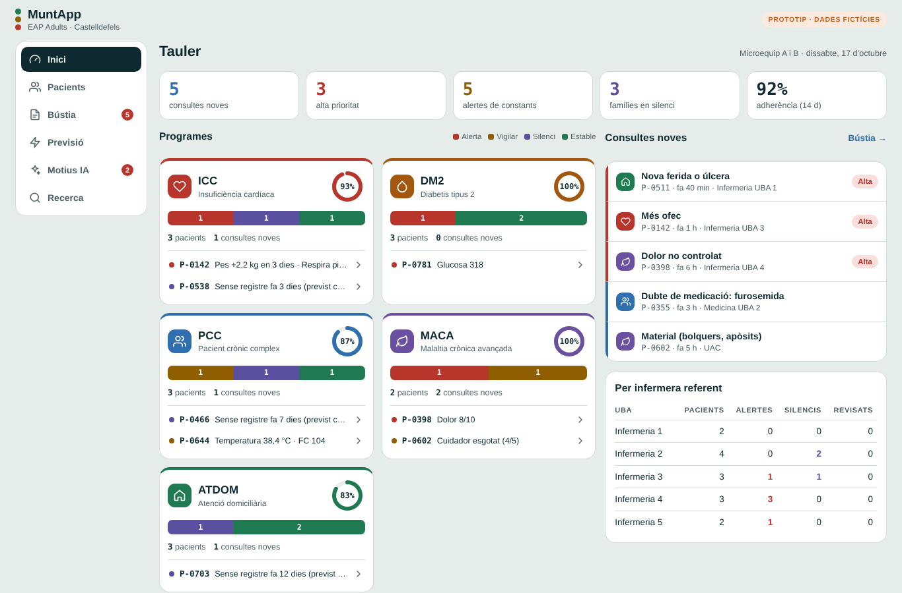
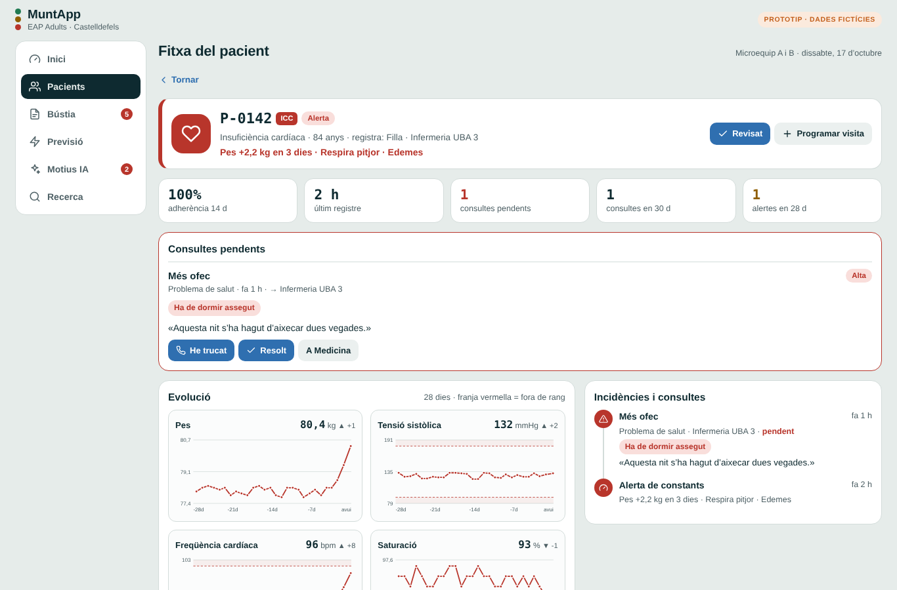

# MuntApp · InnovaMunt

Prototip web per a l’**EAP Adults La Muntanyeta** (Castelldefels): previsió de la demanda per a l’equip i accés directe dels pacients i les famílies al professional que els cal, sense traspassos.

> **Prototip de demostració amb dades fictícies.** No és un producte sanitari ni està connectat a cap sistema clínic. No hi introduïu dades reals de pacients.

**Demo:** https://jotamoga.github.io/muntapp/

**InnovaMunt (mòbil)**

| Inici | Qui sou? | Assistent | Enviat |
| --- | --- | --- | --- |
|  |  |  |  |

**MuntApp (web i mòbil)**

| Tauler | Fitxa del pacient | Bústia | Previsió |
| --- | --- | --- | --- |
|  |  |  |  |

## Què és

Una sola pàgina web amb dues portes. El model és semblant a la eConsulta, però amb el seguiment dels programes de crònics integrat.

### InnovaMunt · pacients i famílies (pensat per al mòbil)

Un assistent pas a pas, amb una pantalla per decisió i barra de progrés:

1. **Usuari:** ICC, DM2, PCC, MACA o ATDOM.
2. **Motiu:** constants, problema de salut, medicació o tràmits.
3. **Detall:**
   - **Problema de salut:** l’assistent entén el text lliure («fa 5 dies que no fa caca») i proposa fins a 3 opcions amb el grau de confiança. També hi ha els problemes més habituals de cada perfil i 12 categories amb més de 45 problemes. Cada problema pregunta els seus signes d’alarma, amb foto opcional.
   - **Constants:** amb els últims valors ja posats i botons + i −.
   - **Medicació** i **tràmits:** pantalles pròpies.
4. **Destinatari:** infermeria, medicina, treball social o UAC, amb l’opció recomanada marcada.
5. **Enviar:** resum i un sol resultat gràfic (urgent 112, prioritat alta, revisar avui, rebut o tot correcte).

### MuntApp · equip (web i mòbil)

- **Tauler:** indicadors clau i una targeta per programa (ICC, DM2, PCC, MACA, ATDOM) amb la barra d’estat, l’adherència i els pacients que requereixen atenció. Inclou les consultes noves, els registres diaris per programa i el seguiment per infermera referent.
- **Pacients:** filtre per programa i cerca. Cada fila mostra l’estat, el motiu, la tendència i l’adherència.
- **Fitxa del pacient:** consultes pendents amb accions, gràfiques d’evolució de 28 dies amb els llindars d’alerta, calendari de registres, últims valors i cronologia d’incidències i consultes.
- **Bústia:** consultes pendents i ateses, filtrades per destinatari, amb «He trucat», «Resolt» o passar-la directament a un altre professional.
- **Previsió:** visites i minuts lliures per UBA i microequip, semàfor de càrrega, escenaris i ordre de suport.
- **Motius IA:** textos lliures de les famílies. Si un motiu es repeteix 3 vegades o més en 30 dies, l’assistent proposa afegir-lo com a opció o crear-ne una de nova. L’equip decideix.
- **Recerca:** indicadors dels estudis de l’equip.

## Implantació per fases

| Fase | Contingut |
| --- | --- |
| 1 | Quadre de comandament amb dades corporatives disponibles (SISAP i explotacions de l’eCAP). |
| 2 | Talls automàtics a les 14 h i a les 19.45 h, amb validació de Sistemes d’Informació i del delegat de protecció de dades. |
| 3 | InnovaMunt: seguiment amb la família i recerca de l’equip. |

## Limitacions d’aquesta demo

- Totes les dades són fictícies i es generen en obrir la pàgina; es perden en recarregar-la.
- L’assistent de text lliure és un classificador de paraules clau (català i castellà) que simula el comportament d’un model d’IA. En una versió real caldria un model validat clínicament i la confirmació d’un professional.
- Els llindars d’alerta, els signes d’alarma i els destinataris són exemples a validar amb els protocols de l’equip.
- Les fotos no surten del dispositiu.

## Publicar-la amb GitHub Pages

1. Pugeu `index.html`, `README.md` i la carpeta `docs/` a l’arrel del repositori.
2. A **Settings → Pages**, a «Build and deployment», trieu **Deploy from a branch**, la branca `main` i la carpeta `/ (root)`.
3. Al cap d’un minut, la web és a `https://USUARI.github.io/NOM-DEL-REPOSITORI/`.

Accessos directes:

- `…/#innovamunt` obre directament InnovaMunt.
- `…/#muntapp` obre directament MuntApp.

## Estructura

```
index.html   La web completa (HTML, CSS i JavaScript en un sol fitxer)
README.md    Aquest document
docs/        Captures de pantalla
```

No necessita cap instal·lació ni servidor: només un navegador. Les fonts tipogràfiques es carreguen de Google Fonts; sense connexió, es fa servir la font del sistema.

## Autoria

Joan Mora García · Infermer d’atenció primària, CASAP Castelldefels.
Projecte de co-direcció de l’EAP Adults La Muntanyeta, 2026.
