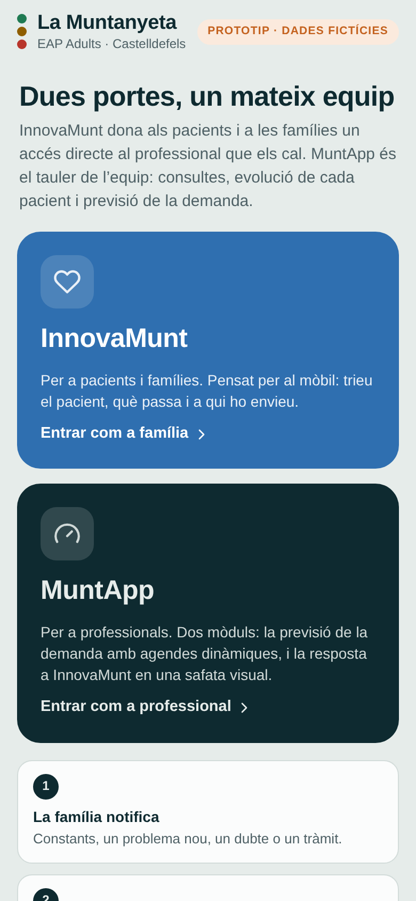
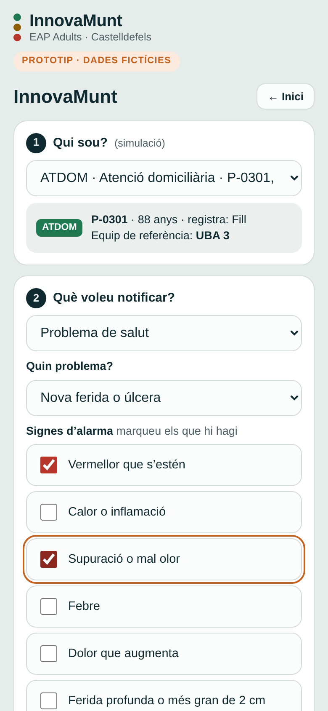
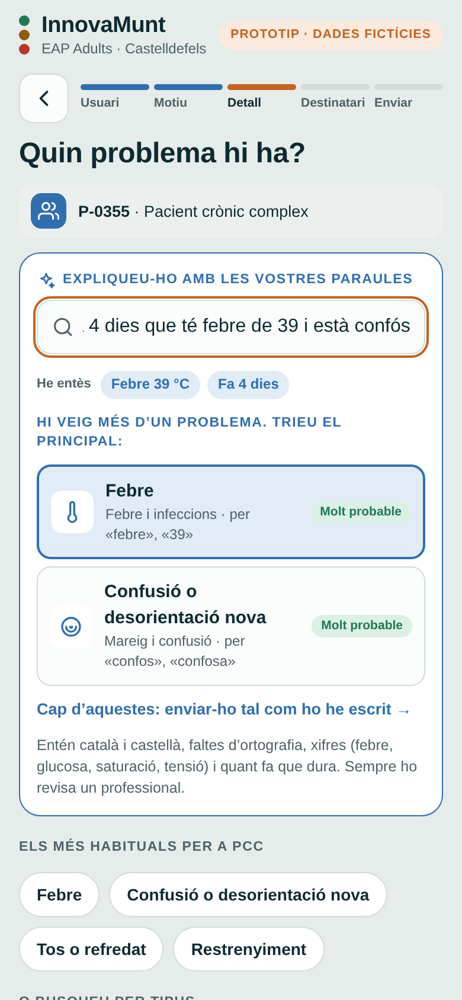
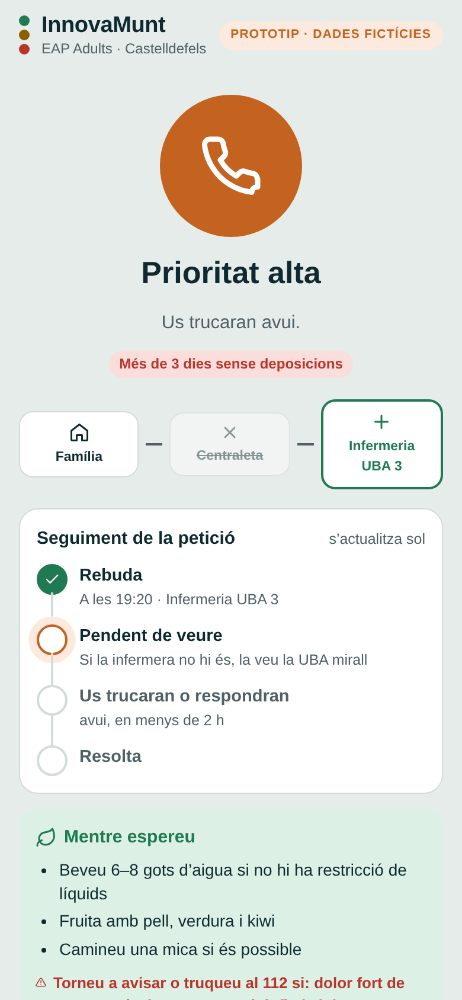
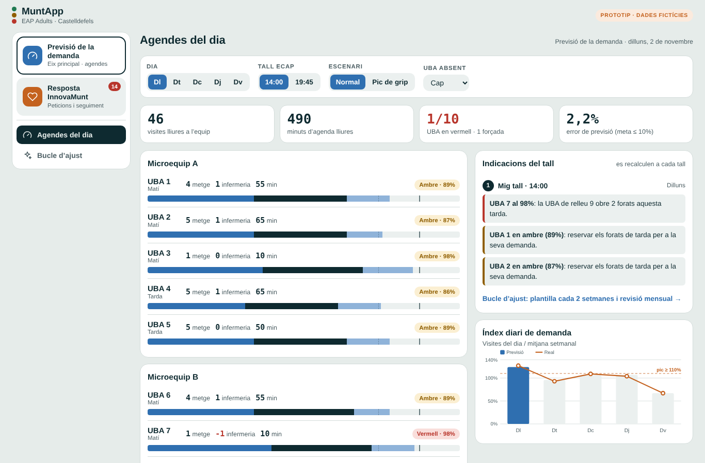
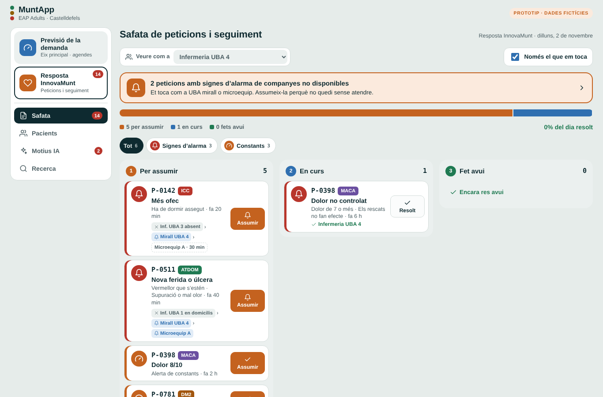
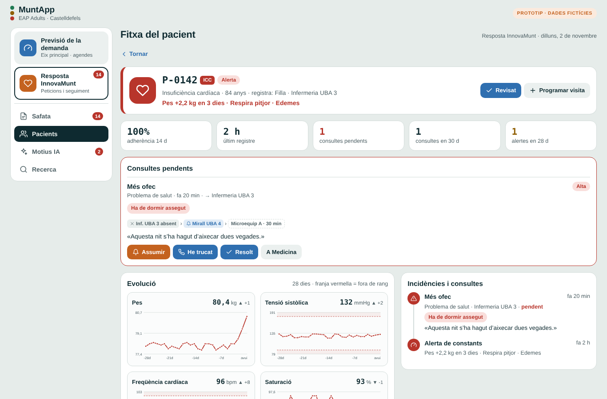

# MuntApp · InnovaMunt

Prototip web per a l’**EAP Adults La Muntanyeta** (Castelldefels): previsió de la demanda per a l’equip i accés directe dels pacients i les famílies al professional que els cal, sense traspassos.

> **Prototip de demostració amb dades fictícies.** No és un producte sanitari ni està connectat a cap sistema clínic. No hi introduïu dades reals de pacients.

**Demo:** https://jotamoga.github.io/muntapp/

**InnovaMunt (mòbil)**

| Inici | Qui sou? | Assistent | Enviat |
| --- | --- | --- | --- |
|  |  |  |  |

**MuntApp (web i mòbil)**

| Previsió de la demanda | Safata InnovaMunt | Fitxa del pacient |
| --- | --- | --- |
|  |  |  |

## Què és

Una sola pàgina web amb dues portes. El model és semblant a la eConsulta, però amb el seguiment dels programes de crònics integrat.

### InnovaMunt · pacients i famílies (pensat per al mòbil)

Un assistent pas a pas, amb una pantalla per decisió i barra de progrés:

1. **Usuari:** ICC, DM2, PCC, MACA o ATDOM.
2. **Motiu:** constants, problema de salut, medicació o tràmits.
3. **Detall:**
   - **Problema de salut:** l’assistent entén el text lliure («fa 3 dies que té febre de 39 i està confós») i proposa fins a 3 opcions amb el grau de confiança i el motiu. Cobreix 92 problemes en 14 categories (pell, digestiu, respiració, cor, dolor, orina i sondes, neurologia, febre, diabetis, mobilitat, ànim, cuidador, ulls-oïda-boca i medicació). Cada problema pregunta els seus signes d’alarma, amb foto opcional.
   - **Què entén l’assistent:** català i castellà, sinònims i expressions col·loquials, faltes d’ortografia, negacions («no té febre») i combinacions de part del cos i símptoma («el genoll calent i inflat»). Llegeix xifres (febre, glucosa, saturació, tensió, pulsacions, pes i dolor de 0 a 10) i quant fa que dura, i ho mostra a «He entès».
   - **Signes marcats automàticament:** si el text ja respon una pregunta (per exemple, febre de 39 o pren Sintrom), el signe surt marcat perquè la família el revisi.
   - **Avís d’urgència:** si el text descriu un signe greu (dolor al pit amb suor, boca torta, convulsió, llavis morats, sagnat important, reacció al·lèrgica greu, saturació o glucosa molt baixes, idees de fer-se mal), mostra «Truqueu ara al 112» abans de continuar.
   - **Constants:** amb els últims valors ja posats i botons + i −.
   - **Medicació** i **tràmits:** pantalles pròpies.
4. **Destinatari:** infermeria, medicina, treball social o UAC, amb l’opció recomanada marcada.
5. **Enviar:** resum i un sol resultat gràfic (urgent 112, prioritat alta, revisar avui, rebut o tot correcte).
6. **Seguiment de la petició:** la família veu si l’han rebuda, qui l’ha assumit, quan la trucaran i quan s’ha resolt (també a «Les meves peticions»), amb consells d’autocura mentre espera i quan tornar a avisar.

### MuntApp · equip (web i mòbil)

Dos mòduls separats:

**1. Previsió de la demanda (eix principal del projecte)**

- **Agendes del dia:** visites i minuts lliures per UBA i microequip, semàfor de càrrega, escenaris (pic de grip, UBA absent) i ordre de suport. Indicacions de cada tall:
  - **Mig tall (14 h):** quina UBA de relleu obre forats i si la demanda creix respecte a la setmana anterior.
  - **Final del dia (19.45 h):** proposta per a la setmana vinent (moure controls de crònics estables al dia amb menys càrrega), amb el botó «Aplicar».
- **Bucle d’ajust:** cada 2 setmanes, recalibrar la plantilla de cada dia segons la tendència; cada mes, tendència de 4 setmanes i error de previsió per revisar-ho amb l’equip (PDCA). Cada ajust aplicat mostra el seu efecte i es pot desfer.

**2. Resposta InnovaMunt**

- **Safata:** totes les peticions i alertes en un sol flux visual de tres columnes, **Per assumir → En curs → Fet avui**, amb una barra de progrés del dia. Cada targeta té un color i una icona segons el tipus (signes d’alarma, consultes, constants, sense seguiment, risc creixent, tràmits) i un sol botó: «Assumir» i després «Resolt», «Revisat» o «He trucat». Per defecte, cada infermera veu només el que li toca.
  - **Escalat dels signes d’alarma:** si la infermera referent no està disponible, la petició arriba també a la seva **UBA mirall**; si ningú l’assumeix en 30 minuts, avisa tot el **microequip**. Els signes urgents avisen el microequip a l’instant.
  - **Sense seguiment:** l’app envia un recordatori automàtic a la família i, si en 24 h no respon, avisa que cal trucar.
  - **Abans de l’alerta:** pacients encara dins de rang però amb una tendència que s’hi acosta, per fer una trucada preventiva.
- **Pacients** i **fitxa del pacient:** evolució de 28 dies amb els llindars d’alerta, calendari de registres i cronologia d’incidències i consultes.
- **Motius IA:** si un motiu escrit amb text lliure es repeteix 3 vegades o més en 30 dies, l’assistent proposa afegir-lo com a opció. L’equip decideix.
- **Recerca:** indicadors dels estudis de l’equip i seguiment per infermera referent.

## InnovaMunt, La Meva Salut i eOSS

InnovaMunt no vol ser una altra app. La eConsulta de La Meva Salut és la porta d’entrada de tot Catalunya, però és asíncrona i no pregunta signes d’alarma. eOSS (Hospital de Bellvitge) fa telemonitoratge excel·lent de la insuficiència cardíaca, liderat des de l’hospital. InnovaMunt aporta el que falta a l’atenció primària: tots els programes de crònics i el domicili, la infermera de la UBA i el microequip, el cuidador com a usuari i la connexió amb les agendes. Està pensat per integrar-se a La Meva Salut (HES) i conviure amb eOSS.

## Implantació per fases

| Fase | Contingut |
| --- | --- |
| 1 | Quadre de comandament amb dades corporatives disponibles (SISAP i explotacions de l’eCAP). |
| 2 | Talls automàtics a les 14 h i a les 19.45 h, amb validació de Sistemes d’Informació i del delegat de protecció de dades. |
| 3 | InnovaMunt: seguiment amb la família i recerca de l’equip. |

## Limitacions d’aquesta demo

- Totes les dades són fictícies i es generen en obrir la pàgina; es perden en recarregar-la.
- L’assistent de text lliure funciona al mateix dispositiu, sense enviar el text enlloc: combina un diccionari clínic (català i castellà), una capa de parts del cos i símptomes, la lectura de xifres i la detecció de signes d’alarma. S’ha provat amb 311 frases escrites com les escriuria una família. No és un producte sanitari: en una versió real caldria un model validat clínicament, i cada classificació la confirma un professional.
- Els llindars d’alerta, els signes d’alarma i els destinataris són exemples a validar amb els protocols de l’equip.
- Les fotos no surten del dispositiu.

## Publicar-la amb GitHub Pages

1. Pugeu `index.html`, `README.md` i la carpeta `docs/` a l’arrel del repositori.
2. A **Settings → Pages**, a «Build and deployment», trieu **Deploy from a branch**, la branca `main` i la carpeta `/ (root)`.
3. Al cap d’un minut, la web és a `https://USUARI.github.io/NOM-DEL-REPOSITORI/`.

Accessos directes:

- `…/#innovamunt` obre directament InnovaMunt.
- `…/#muntapp` obre directament MuntApp.

## Estructura

```
index.html   La web completa (HTML, CSS i JavaScript en un sol fitxer)
README.md    Aquest document
docs/        Captures de pantalla
```

No necessita cap instal·lació ni servidor: només un navegador. Les fonts tipogràfiques es carreguen de Google Fonts; sense connexió, es fa servir la font del sistema.

## Autoria

Joan Mora García · Infermer d’atenció primària, CASAP Castelldefels.
Projecte de co-direcció de l’EAP Adults La Muntanyeta, 2026.
