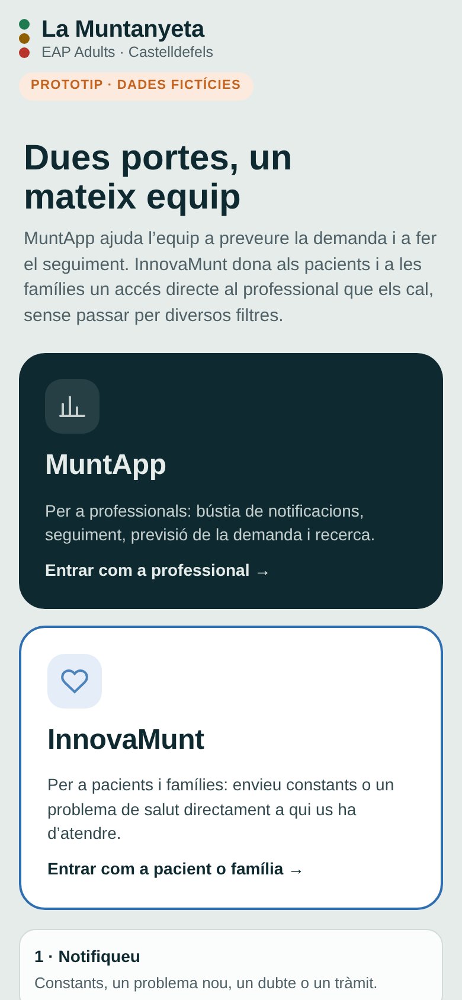
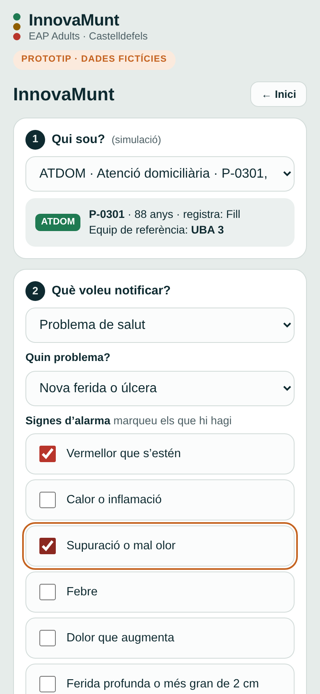
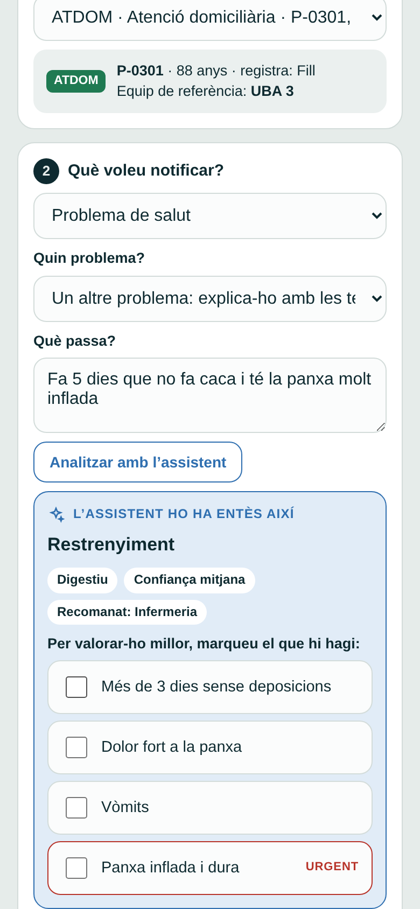
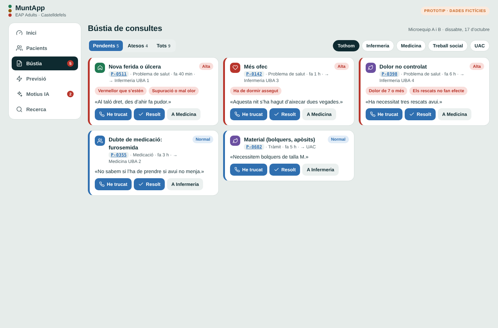
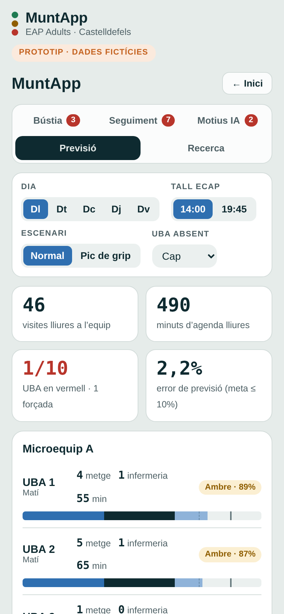

# MuntApp · InnovaMunt

Prototip web per a l’**EAP Adults La Muntanyeta** (Castelldefels): previsió de la demanda per a l’equip i accés directe dels pacients i les famílies al professional que els cal, sense traspassos.

> **Prototip de demostració amb dades fictícies.** No és un producte sanitari ni està connectat a cap sistema clínic. No hi introduïu dades reals de pacients.

**Demo:** https://USUARI.github.io/muntapp/ *(substituïu-ho per l’adreça de GitHub Pages)*

| Inici | InnovaMunt | Assistent | Bústia de l’equip | Previsió |
| --- | --- | --- | --- | --- |
|  |  |  |  |  |

## Què és

Una sola pàgina web, pensada per al mòbil, amb dues portes:

### InnovaMunt · pacients i famílies

1. **Qui sou?** Perfil del pacient: ICC, DM2, PCC, MACA o ATDOM.
2. **Què voleu notificar?**
   - **Constants** pròpies de cada perfil (pes, tensió, glucosa, saturació, dolor…).
   - **Problema de salut** amb els seus signes d’alarma (per exemple, una ferida nova en ATDOM) i foto opcional.
   - **Un altre problema**, amb text lliure: l’assistent el classifica, pregunta els signes d’alarma d’aquell motiu i el dirigeix al professional adequat.
   - **Dubte de medicació** o **tràmit** (recepta, informe, baixa, material).
3. **A qui ho envieu?** Infermeria, Medicina, Treball social o UAC, amb una opció recomanada.

La notificació arriba directament al professional, amb la prioritat calculada. Els signes urgents mostren l’avís de trucar al 112.

### MuntApp · equip

- **Bústia:** notificacions ordenades per prioritat, amb signes, foto i nota. El professional pot marcar «He trucat», «Resolt» o passar-la directament a un altre professional.
- **Seguiment:** alertes de constants, famílies que han deixat de registrar i qui fa seguiment i qui no, per infermera referent.
- **Motius IA:** motius escrits amb text lliure. Si un motiu es repeteix 3 vegades o més en 30 dies, l’assistent proposa afegir-lo com a opció fixa o crear una categoria nova. L’equip decideix.
- **Previsió:** visites i minuts lliures per UBA i microequip, semàfor de càrrega, escenaris de pic de grip i d’UBA absent, i ordre de suport.
- **Recerca:** indicadors dels estudis de l’equip (ICC, DM2, PCC/MACA, ATDOM).

## Implantació per fases

| Fase | Contingut |
| --- | --- |
| 1 | Quadre de comandament amb dades corporatives disponibles (SISAP i explotacions de l’eCAP). |
| 2 | Talls automàtics a les 14 h i a les 19.45 h, amb validació de Sistemes d’Informació i del delegat de protecció de dades. |
| 3 | InnovaMunt: seguiment amb la família i recerca de l’equip. |

## Limitacions d’aquesta demo

- Totes les dades són fictícies i es generen en obrir la pàgina; es perden en recarregar-la.
- L’assistent de text lliure és un classificador de paraules clau que simula el comportament d’un model d’IA. En una versió real caldria un model validat clínicament i la confirmació d’un professional.
- Els llindars d’alerta, els signes d’alarma i els destinataris són exemples a validar amb els protocols de l’equip.
- Les fotos no surten del dispositiu.

## Publicar-la amb GitHub Pages

1. Pugeu `index.html`, `README.md` i la carpeta `docs/` a l’arrel del repositori.
2. A **Settings → Pages**, a «Build and deployment», trieu **Deploy from a branch**, la branca `main` i la carpeta `/ (root)`.
3. Al cap d’un minut, la web és a `https://jotamoga.github.io/NOM-DEL-REPOSITORI/`.

Accessos directes:

- `…/#innovamunt` obre directament InnovaMunt.
- `…/#muntapp` obre directament MuntApp.

## Estructura

```
index.html   La web completa (HTML, CSS i JavaScript en un sol fitxer)
README.md    Aquest document
docs/        Captures de pantalla
```

No necessita cap instal·lació ni servidor: només un navegador. Les fonts tipogràfiques es carreguen de Google Fonts; sense connexió, es fa servir la font del sistema.

## Autoria

Joan Mora García · Infermer d’atenció primària, CASAP Castelldefels.
Projecte de co-direcció de l’EAP Adults La Muntanyeta, 2026.
